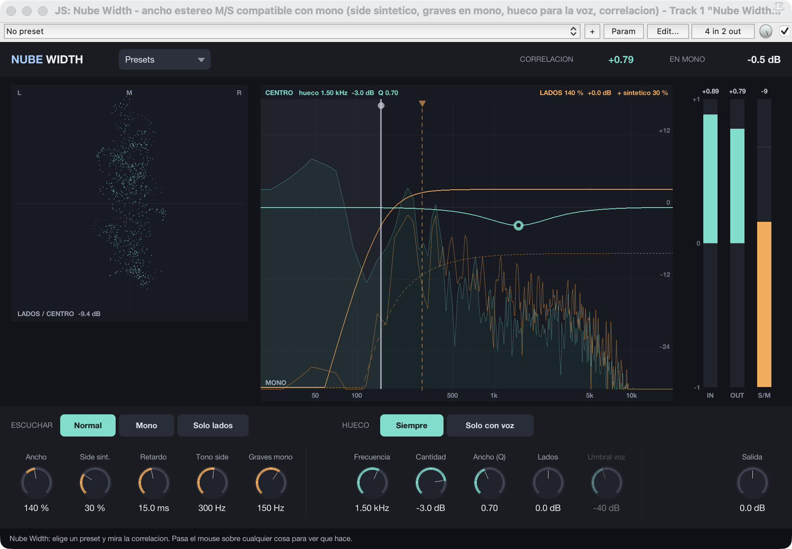

<!-- en -->
# Nube Width

A free, mono-safe stereo width tool for [REAPER](https://www.reaper.fm), written as a JSFX (macOS / Windows / Linux), part of the
[Nube plugins](https://github.com/KevinMeneses/nube-plugins).



Mid/Side width, a synthetic side that cancels in mono (Haas-style widener), mono bass below a frequency, a "vocal pocket" that
dips only the center in the vocal range (always or keyed by the vocal on channels 3/4), goniometer, live mid/side spectrum,
correlation and side/mid meters, mono / side-only listening and 21 presets. Every control only touches the side signal except
the vocal pocket, so **the mono fold-down never changes** (verified sample by sample). ~0.35 % CPU.

**Install** — with [ReaPack](https://reapack.com): *Extensions → ReaPack → Import repositories*, paste
`https://github.com/KevinMeneses/nube-plugins/raw/main/index.xml`, then install **Nube Width**. Or copy `nube_width.jsfx`
into `REAPER/Effects/Nube Width/` (on macOS `./install.sh` links it). It shows up as **JS: Nube Width**. The interface is in Spanish.

**How it was made** — designed and built with [Claude Code](https://claude.com/claude-code). Since an AI can't
listen, every feature is verified by rendering test cases inside REAPER and comparing them with the theory and with the
original JSFX it replaces (`tests/run.sh`), plus mouse-driven UI tests (`tests/ui_test.py`).

**License** — GPL-3.0-or-later (see `LICENSE`).

---

## Español
Ancho estéreo para REAPER (JSFX, macOS/Windows/Linux), hermano de [Nube EQ](https://github.com/KevinMeneses/nube-eq), [Nube Comp](https://github.com/KevinMeneses/nube-comp),
[Nube De-Ess](https://github.com/KevinMeneses/nube-deess) y los demás. Une en uno solo los tres JSFX que usé en "Nube baja"
(`claude_widener`, `claude_width` y `claude_center_carve`) y suena **idéntico** a esa cadena con los mismos ajustes.


Procesa en Mid/Side, en este orden (el mismo de la cadena del Rhodes):

1. **Side sintético** (el widener): una copia del centro, retrasada (2–30 ms) y con pasa-altos, se suma a L y se resta en R.
   Abre sonidos mono. En mono (L+R) se cancela exacto.
2. **Ancho**: sube o baja los lados reales (0 % = mono, 100 % = igual, hasta 300 %).
3. **Graves en mono**: debajo de la frecuencia elegida los lados se van (Linkwitz-Riley de 24 dB/oct, −6 dB en la
   frecuencia). Solo se filtran los lados: el centro y el mono no se tocan.
4. **Hueco en el centro**: una campana que baja solo el centro en la zona de la voz (frecuencia, cantidad y ancho Q).
   Los lados quedan igual o se suben con **Lados**. Puede actuar **siempre** o **solo cuando hay voz** (la voz entra por
   los canales 3/4 de la pista, con umbral). Es lo único que cambia el mono, y lo cambia exactamente con esa campana.

Además: **goniómetro**, **espectro en vivo** del centro (turquesa) y de los lados (naranjo) con las curvas encima,
**correlación** de entrada y salida (con la mínima reciente), **lados/centro** en dB, cuánto baja el volumen **en mono**,
y botones para **escuchar en mono** o **solo los lados**. Ayuda en el pie de la ventana para todo lo que tienes bajo el mouse.

## Instalar

```sh
./install.sh
```

Crea un enlace en `~/Library/Application Support/REAPER/Effects/Nube Width/`. En REAPER aparece como
**JS: Nube Width**. Si cambias el código, vuelve a insertar el FX.

## Cómo se usa

| Acción | Cómo |
|---|---|
| Ancho | Perilla, o **arrastra arriba/abajo** en el goniómetro o en el panel de frecuencias (rueda también) |
| Hueco | **Arrastra el punto**: izquierda/derecha = frecuencia, arriba/abajo = cantidad; **rueda = Q**; doble clic = sin hueco |
| Graves en mono | **Arrastra la línea gris**; todo a la izquierda = apagado; doble clic = 120 Hz / apagado |
| Tono del side sintético | Arrastra la línea naranja punteada |
| Perillas | Arrastra arriba/abajo o rueda; **Shift** = fino; **doble clic** = valor por defecto |
| Presets | Botón *Presets* o clic derecho en las gráficas |
| Medidores | Clic = reiniciar la correlación mínima |

Para revisar el mono: pon **Escuchar → Mono**. Debe sonar igual de fuerte que con el plugin apagado (solo cambia el
hueco, si lo usas). **Solo lados** muestra lo que desaparece en mono: no debería quedar bajo ni bombo ahí.
Correlación: +1 = mono, ~0.5–0.8 = ancho normal de una mezcla, cerca de 0 = muy ancho, negativa = fuera de fase.

## Parámetros

| # | Parámetro | Rango | Por defecto |
|---|---|---|---|
| 1 | Ancho | 0–300 % | 100 % |
| 2 | Side sintético | 0–100 % | 0 (apagado) |
| 3 | Retardo del side | 2–30 ms | 14 ms |
| 4 | Tono del side (pasa-altos) | 80–1000 Hz | 250 Hz |
| 5 | Graves en mono hasta | 20–500 Hz (20 = apagado) | apagado |
| 6 | Hueco: frecuencia | 200–6000 Hz | 1.2 kHz |
| 7 | Hueco: cantidad | −15–0 dB | 0 (sin hueco) |
| 8 | Hueco: ancho (Q) | 0.2–4 | 0.6 |
| 9 | Lados | ±6 dB | 0 |
| 10 | Hueco: modo | Siempre / Solo con voz (3/4) | Siempre |
| 11 | Umbral de voz | −70–0 dB | −40 |
| 12 | Activo desde (s) | 0–600 s | 0 |
| 13 | Salida | ±12 dB | 0 |
| 14 | Escuchar | Normal / Mono / Solo lados | Normal |

Por defecto no hace nada (la salida es idéntica a la entrada, bit a bit). *Activo desde* existe para reproducir la mezcla
de Nube baja: antes de ese tiempo el hueco y *Lados* no actúan (el ancho y el side sintético sí, como en el original).

## Presets

| Preset | Qué hace |
|---|---|
| Nube baja - Rhodes (cadena completa) | La cadena del Rhodes: side sintético 40 % (14 ms, 250 Hz), ancho 160 %, hueco 1.2 kHz −5 dB Q0.6, lados +1.5, solo con voz, desde 12.8 s |
| Nube baja - Hook (voz) | Side sintético 35 % (14 ms, 250 Hz), el de la voz del hook |
| Pads / acordes anchos | Ancho 140, sintético 30 % (15 ms, 300 Hz), graves mono 150, hueco 1.5 kHz −3 |
| Melodía / lead ancho | Ancho 120, sintético 35 % (12 ms, 400 Hz), graves mono 150 |
| Coros y dobles | Ancho 150, graves mono 200, hueco 1.2 kHz −4 |
| Voz principal (centrada) | Ancho 80, graves mono 200 |
| 808 / bajo (todo mono) | Ancho 0 |
| Bajo con armónicos anchos | Ancho 120, graves mono 200 |
| Hi-hats / percusión | Ancho 120, sintético 30 % (9 ms, 1 kHz), graves mono 300 |
| Clap / snare | Sintético 25 % (9 ms) — el del clap de Nube baja |
| Guitarra / stab (dancehall) | Sintético 35 % (14 ms, 300 Hz), graves mono 150 |
| Órgano (dancehall) | Sintético 30 % (14 ms), graves mono 150 |
| Pluck / kalimba | Ancho 130, sintético 25 % (11 ms, 400 Hz), hueco 1.2 kHz −3 |
| Silbido / flauta | Sintético 25 % (11 ms), hueco 1.5 kHz −3 |
| Reverb o delay (retorno) | Ancho 130, graves mono 300, hueco 1.5 kHz −3 |
| Instrumental: hueco para la voz | Ancho 110, graves mono 120, hueco 1.5 kHz −3 Q0.5, lados +1 |
| Instrumental: hueco solo con voz (3/4) | Ancho 110, graves mono 120, hueco 1.2 kHz −6, lados +1.5, solo con voz |
| Master: un poco más ancho | Ancho 115, graves mono 120 |
| Master: más angosto | Ancho 70, graves mono 150 |
| Todo mono | Ancho 0 |
| Por defecto | Nada |

## Pruebas

```sh
until mkdir /tmp/nube-reaper.lock 2>/dev/null; do sleep 5; done; NUBE_PY=~/Music/ClaudeBeats/.venv/bin/python tests/run.sh; rmdir /tmp/nube-reaper.lock
```

`tests/run.sh` renderiza ~50 casos en una pestaña temporal de REAPER y `tests/check.py` los compara con la teoría y con
los JSFX originales (necesita numpy, scipy y soundfile; las señales salen de la instrumental de Nube baja). Resultados:

- **Igual a los originales**: widener, ancho, hueco, hueco con voz, la cadena completa del Rhodes y el preset
  "Nube baja" (con *desde 12.8 s*): diferencia máxima −138 dBFS (el último bit del WAV de 24 bit) o 0.
- **Por defecto**: salida = entrada, bit a bit.
- **Mono**: con todo al máximo (ancho 300 %, sintético 100 %, graves mono 200 Hz, lados +6) el (L+R)/2 de salida es igual al
  de entrada (−144 dBFS) y la loudness en mono cambia 0.00 LU, aunque la correlación baja a −0.89. Side sintético 100 % sobre
  audio mono: L +0.8 LU, R +2.0 LU, mono −0.000 LU.
- **Graves en mono**: centro plano ±0.000 dB; lados = Linkwitz-Riley teórico ±0.05 dB (50 Hz −38 dB, 100 Hz −16, 150 Hz −6).
- **Hueco**: el centro sigue la campana RBJ ±0.02 dB; los lados quedan planos ±0.000 dB.
- **Presets** sobre la instrumental de Nube baja: el mono de salida es exactamente el mono de entrada pasado por la campana
  del hueco (error ≤ −119 dB). No hay filtrado de peine ni otro cambio de timbre en mono.

Interfaz: `NUBE_PRESET=3 tests/reopen.sh` abre una demo (`NUBE_SHOT=archivo.png` captura solo la ventana del FX, sin traerla
al frente). `tests/ui_test.py` prueba con el mouse (cliclick): trae REAPER al frente, así que no lo corras mientras usas la Mac.
CPU: `tests/perf.lua`.
